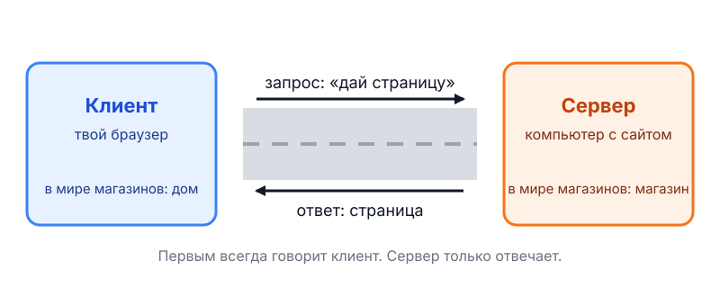

# 01. Как работает интернет

Рассмотрим кратко, как работает интернет. Ты вводишь в браузере `google.com` и жмёшь Enter. Дальше происходит три вещи:

1. Браузер отправляет серверу Google запрос: «дай главную страницу».
2. Сервер отвечает: статус (`200 OK` — всё в порядке), заголовки и тело, то есть HTML.
3. Браузер рисует страницу из полученного HTML.

Две роли в этой схеме:

- клиент инициирует запрос: браузер, `curl`, любая программа;
- сервер отвечает: программа на машине, где лежит сайт.

HTTP — текстовый протокол «запрос — ответ». Сервер сам никому ничего не присылает: первым всегда говорит клиент.



## Поднимаем сервер

Поднимем сервер на PHP и на Python и будем его менять по шагам. Нужно два окна терминала: в одном работает сервер, из другого мы к нему обращаемся.

Команды ниже даны для WSL. Если работаешь в PowerShell, пиши `curl.exe` вместо `curl` и `python` вместо `python3`.

## Шаг 1. Hello

PHP, файл `index.php`:

```php
<?php

declare(strict_types=1);

header('Content-Type: text/plain; charset=utf-8');
echo "Привет из PHP\n";
```

Python, файл `server.py`:

```python
from http.server import BaseHTTPRequestHandler, HTTPServer


class Handler(BaseHTTPRequestHandler):
    def do_GET(self) -> None:
        body = "Привет из Python\n".encode("utf-8")
        self.send_response(200)
        self.send_header("Content-Type", "text/plain; charset=utf-8")
        self.send_header("Content-Length", str(len(body)))
        self.end_headers()
        self.wfile.write(body)


HTTPServer(("127.0.0.1", 8001), Handler).serve_forever()
```

Запуск, в первом окне (PHP в одной папке, Python в другой):

```bash
php -S 127.0.0.1:8000
python3 server.py
```

`127.0.0.1` — адрес твоего же компьютера, а `8000` и `8001` — порты: числа, по которым клиент находит нужную программу на машине.

Теперь клиент. Открой в браузере `http://127.0.0.1:8000` и `http://127.0.0.1:8001`. Во втором окне:

```bash
curl -i http://127.0.0.1:8000/
curl -i http://127.0.0.1:8001/
```

Флаг `-i` показывает ещё и служебные строки: статус `200 OK`, заголовки, потом пустую строку и тело. Посмотри и на окно сервера: там появилась запись о каждом запросе.

## Шаг 2. Отдаём HTML

В PHP замени две строки:

```php
header('Content-Type: text/html; charset=utf-8');
echo "<h1>Привет из PHP</h1>\n";
```

В Python замени `text/plain` на `text/html` и текст ответа:

```python
body = "<h1>Привет из Python</h1>".encode("utf-8")
self.send_header("Content-Type", "text/html; charset=utf-8")
```

Сохрани и обнови страницу в браузере. Браузер нарисовал большой заголовок, а `curl` по-прежнему показывает сырой текст с тегом `<h1>`. Разница в одной строке: заголовок `Content-Type` объясняет клиенту, как показывать тело.

Python-сервер при этом надо остановить (`Ctrl+C`) и запустить заново: он читает код один раз при старте. PHP перечитывает `index.php` на каждый запрос, поэтому ему перезапуск не нужен.

## Шаг 3. Разные страницы и 404

Пусть сервер смотрит на путь запроса и отвечает по-разному.

PHP:

```php
<?php

declare(strict_types=1);

header('Content-Type: text/html; charset=utf-8');

$path = parse_url($_SERVER['REQUEST_URI'], PHP_URL_PATH);

if ($path === '/') {
    echo "<h1>Главная</h1>\n";
} elseif ($path === '/hello') {
    echo "<h1>Привет из PHP</h1>\n";
} else {
    http_response_code(404);
    echo "<h1>Такой страницы нет</h1>\n";
}
```

Python:

```python
from http.server import BaseHTTPRequestHandler, HTTPServer


class Handler(BaseHTTPRequestHandler):
    def do_GET(self) -> None:
        if self.path == "/":
            self.reply(200, "<h1>Главная</h1>")
        elif self.path == "/hello":
            self.reply(200, "<h1>Привет из Python</h1>")
        else:
            self.reply(404, "<h1>Такой страницы нет</h1>")

    def reply(self, status: int, html: str) -> None:
        body = html.encode("utf-8")
        self.send_response(status)
        self.send_header("Content-Type", "text/html; charset=utf-8")
        self.send_header("Content-Length", str(len(body)))
        self.end_headers()
        self.wfile.write(body)


HTTPServer(("127.0.0.1", 8001), Handler).serve_forever()
```

Проверь три адреса: `/`, `/hello` и `/nope`, в браузере и через `curl -i`. У последнего статус `404 Not Found`. В браузере нажми `F12`, вкладку `Network`, обнови страницу: код ответа виден и там.

Код статуса — это первая цифра ответа:

| Код | Смысл | Пример |
|-----|-------|--------|
| 2xx | всё хорошо | `200 OK` |
| 3xx | иди в другое место | `302 Found` |
| 4xx | ошибка клиента | `404 Not Found` |
| 5xx | ошибка сервера | `500 Internal Server Error` |

## Шаг 4. Редирект

Добавим старый адрес `/old`, который отправляет на `/hello`.

В PHP новая ветка перед `else`:

```php
} elseif ($path === '/old') {
    header('Location: /hello', true, 302);
```

В Python новая ветка в `do_GET` и новый метод в класс:

```python
        elif self.path == "/old":
            self.redirect("/hello")
```

```python
    def redirect(self, location: str) -> None:
        self.send_response(302)
        self.send_header("Location", location)
        self.send_header("Content-Length", "0")
        self.end_headers()
```

Проверь:

```bash
curl -i http://127.0.0.1:8000/old
curl -iL http://127.0.0.1:8000/old
```

Первая команда показывает `302` и заголовок `Location`. Вторая с флагом `-L` идёт за ним и приходит на `/hello`. Браузер делает `-L` сам, поэтому у него адрес в строке просто меняется на `/hello`.

## Что общего, а что нет

Общее:

- сервер слушает порт и на каждый запрос отдаёт статус, заголовки и тело;
- путь запроса решает, что отвечать;
- `Content-Type` говорит клиенту, как показывать ответ.

Различия:

- PHP запускает `index.php` заново на каждый запрос. Статус `200` и часть заголовков он ставит сам.
- Python-сервер запущен один раз. Ответ ты собираешь вручную: статус, заголовки, тело. Зато видно, из чего он состоит.

## Шпаргалка

- Сервер слушает порт, клиент спрашивает, сервер отвечает.
- Запрос: метод, путь, заголовки. Ответ: статус, заголовки, пустая строка, тело.
- `curl -i` показывает ответ, `curl -iL` идёт по редиректам.
- `Content-Type` решает, как клиент покажет тело.
- `2xx` — хорошо, `3xx` — иди в другое место, `4xx` — ошибка клиента, `5xx` — ошибка сервера.
- PHP перечитывает код на каждый запрос, Python-сервер надо перезапускать.

## Напоследок

1. Код `418 I'm a teapot` существует по-настоящему: «я чайник, кофе не варю». Он родился в 1998 году в шуточной спецификации про управление чайниками по сети и с тех пор кочует по серверам как пасхалка.

2. Заголовок `Referer` (откуда пришёл клиент) написан с ошибкой: по-английски правильно `Referrer`. Опечатка попала в стандарт в 1990-х, исправлять её побоялись, и она живёт в HTTP до сих пор.

3. Команда `php -S` появилась в PHP 5.4 в 2012 году. Встроенный сервер задуман только для разработки, а не для настоящих сайтов. То же относится к `http.server` в Python.

## Практика

### 1.1. Страница со временем

Попроси агента добавить в оба сервера страницу `/time`, которая показывает текущее время. Прими работу сам: открой её в браузере и проверь через `curl -i`. Потом ответь одной фразой: в каком из двух серверов надо перезапускать процесс, чтобы увидеть изменение, и почему.

### 1.2. Закрытая страница

Сформулируй агенту задачу: страница `/secret` отвечает `403 Forbidden` и текстом «Вход закрыт». В задаче должно быть три части: исход, ограничение (какой язык, без сторонних пакетов) и критерий готовности, то есть какие `curl`-команды ты выполнишь. Дай задачу для PHP и для Python и принимай только по своим `curl`, а не по отчёту агента.
