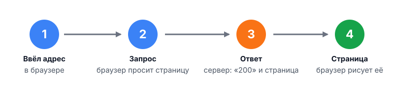

# 01. Как работает веб

Ты просишь агента: «сделай форму регистрации». Через минуту он отвечает: «Готово, всё работает». Ты открываешь страницу, а там пусто. Кто прав?

Чтобы разобраться, нужна самая простая картина: кто с кем говорит и что при этом летит туда и обратно. Её и нарисуем. Без сетей, кабелей и протоколов, это придёт позже.

## После урока ты сможешь

- объяснить, кто такие клиент и сервер;
- пройти путь от ввода адреса до страницы по четырём шагам;
- отличить то, что делает браузер, от того, что делает сервер;
- посмотреть запрос и ответ в браузере и не верить на слово ни себе, ни агенту.

## Дорога, дом и магазин

Представь, что сайт — это магазин. Ты живёшь в доме, магазин стоит на другом конце улицы. Чтобы получить товар, ты идёшь по дороге и делаешь заказ.

В вебе всё так же:

- дом — это клиент: твой браузер на твоём компьютере или телефоне;
- магазин — это сервер: компьютер, на котором лежит сайт;
- дорога — это интернет: по нему идут заказы туда и товары обратно.


Важное правило: первым всегда говорит клиент. Магазин сам не звонит и не присылает товар без заказа. Он только отвечает на заказы.

Клиентом может быть не только браузер. Утилита `curl`, мобильное приложение и твой агент тоже клиенты, когда ходят на сайты.

## Путь от адреса до страницы

Ты вводишь адрес и жмёшь Enter. Дальше всё происходит за долю секунды:



1. Ты вводишь адрес в браузере. Браузер сам находит, где живёт сервер.
2. Браузер отправляет запрос: «дай мне эту страницу».
3. Сервер отвечает. В ответе два главных куска: код («всё хорошо», «такой страницы нет») и сама страница.
4. Браузер получает текст страницы и превращает его в картинку с кнопками.

Заметь: между шагами 3 и 4 меняется работник. Страницу сервер только присылает, а рисует её уже браузер.

## Кто что делает

Эти две половины даже называют по-разному:

- frontend — то, что происходит в браузере: как страница выглядит и ведёт себя;
- backend — то, что происходит на сервере: хранит данные, проверяет пароли, решает, что ответить.

Этот курс про backend. Ты будешь учиться понимать то, что делает магазин за прилавком: какие заказы он принимает, как хранит товар и как не обмануться.

## Адрес

Адрес в браузере выглядит так:

```text
https://example.com/hello
```

В нём два главных куска:

- `example.com` — какой это магазин;
- `/hello` — какой отдел в нём нужен.

`https://` в начале говорит, как общаться: безопасно или нет. Об этом позже.

## Смотрим сами

Откроем настоящую страницу и посмотрим, что именно прилетело.

1. Открой в браузере любой сайт, например `example.com`.
2. Нажми `F12`, чтобы открыть инструменты разработчика.
3. Перейди на вкладку `Network` (сеть) и обнови страницу клавишей `F5`.
4. Нажми на первую строку в списке.

Ты увидишь, как называется страница (путь), каким методом её просили (`GET`) и каким кодом ответил сервер (`200`). Это тот самый заказ и ответ магазина.

Теперь то же без браузера, одной командой в терминале:

```bash
curl -i http://example.com/
```

Сверху идёт код (`HTTP/1.1 200 OK`) и служебные строки, потом пустая строка, а за ней страница в виде текста. Браузер делает то же самое, только после этого ещё и рисует.

## Частые заблуждения

- «Браузер — это окно в сервер». Нет. Браузер получает копию страницы и рисует её у себя. Сервер остаётся там, где был.
- «Если сайт открылся, всё работает». Нет. Страница могла открыться с кодом `200`, а форма на ней отправляться в никуда. Всегда смотри, что именно ответил сервер.
- «Замочек в адресной строке значит, что сайт хороший». Нет. Он значит только, что разговор зашифрован. Мошенник тоже может поставить замочек.

## Шпаргалка

- Клиент спрашивает, сервер отвечает. Первым всегда говорит клиент.
- Путь запроса: ввёл адрес, запрос, ответ, браузер рисует страницу.
- Сервер присылает страницу, а рисует её браузер.
- Frontend — браузер, backend — сервер. Курс про backend.
- Что ответил сервер, видно в `F12`, вкладка `Network`, и командой `curl -i`.
- Отчёту агента верить не надо: надо смотреть на ответ.

## Напоследок

1. Самый первый сайт в мире до сих пор открывается. Он лежит на `info.cern.ch`: просто текст и ссылки, без картинок. Проверь сам: `curl -i http://info.cern.ch/`.

2. Почти весь трафик между континентами идёт не через спутники, а по кабелям на дне океана. Такой кабель примерно как садовый шланг. Когда ты открываешь сайт на другом конце света, ответ, скорее всего, приплывает по дну.

3. Первый браузер назывался WorldWideWeb. Его в 1990 году написал Тим Бернерс-Ли, и он умел не только показывать страницы, но и редактировать их. Потом браузер переименовали в Nexus, чтобы не путать с самой Сетью.

## Практика

### 1.1. Найди заказ

Открой любой сайт, нажми `F12`, вкладка `Network`, обнови страницу. Найди первую строку и выпиши три вещи: путь, метод и код ответа. Потом выполни `curl -i` с тем же адресом и проверь, совпал ли код.

### 1.2. Расскажи путь и проверь

Выбери любимый сайт и своими словами опиши четыре шага, как страница попадает на экран. Дай своё описание агенту и попроси найти в нём неточности. Реши, кто из вас прав, и проверь спорное место через `F12` или `curl -i`.
